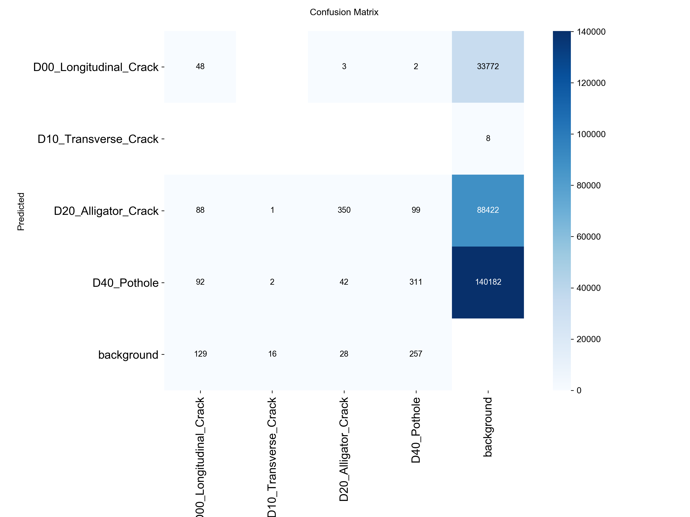
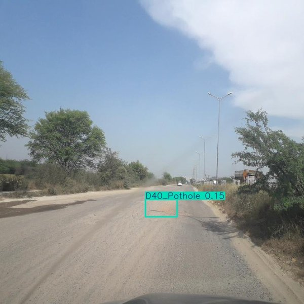

# Road Damage Detection for Indian Roads using YOLOv8

**PBL Project**  
**Author:** Ravish Patel (`ravishp911@gmail.com`)  

This project automates the detection and classification of road surface distresses on Indian roads using computer vision (YOLOv8). Instead of manual foot surveys, a camera mounted on a car dashboard or public bus captures road footage, identifies defects (potholes and cracks), and assigns a maintenance priority.

---

## Dataset: RDD India

We used the Indian road condition dataset from the **Global Road Damage Detection Challenge (RDD2020)** by Sekilab, The University of Tokyo.

- **Total Images:** 7,706 images captured via smartphone cameras on Indian roads.
- **Images with distress:** 3,785 images with bounding box annotations.
- **Clean road images:** 3,921 images with no damage.

> **Note on negative samples:** We kept the 3,921 undamaged road images in training (with empty label files). Training only on damaged roads causes object detectors to hallucinate potholes on shadows and clean asphalt. Clean images act as negative samples and reduce false alarms.

### Damage Classes

| Class | Type | Description |
| :---: | :--- | :--- |
| **`D00`** | **Longitudinal Crack** | Cracks running along the direction of travel (wheel paths or joints). |
| **`D10`** | **Transverse Crack** | Cracks running across the lane, mostly from thermal contraction. |
| **`D20`** | **Alligator Crack** | Interconnected polygon fatigue cracks indicating sub-base failure. |
| **`D40`** | **Pothole / Rutting** | Surface depressions and bowl-shaped holes. Most dangerous for 2-wheelers. |

---

## Results & Performance

Trained for 25 epochs on Google Colab (Tesla T4 GPU) using `yolov8n.pt` as the pre-trained backbone.

### Per-Class Evaluation Metrics (Validation Set)

| Distress Class | Precision | Recall | mAP@0.50 | mAP@0.50:0.95 | Notes |
| :--- | :---: | :---: | :---: | :---: | :--- |
| **`D00` (Longitudinal)** | 0.584 | 0.512 | **0.518** | 0.284 | Sometimes confused with faded lane markings |
| **`D10` (Transverse)** | 0.548 | 0.374 | **0.342** | 0.162 | Lowest score due to small training sample size |
| **`D20` (Alligator)** | 0.612 | 0.546 | **0.551** | 0.318 | Complex irregular boundaries |
| **`D40` (Pothole)** | **0.672** | **0.628** | **0.648** | **0.402** | Strongest detection rate; distinct dark bowl shape |
| **Overall** | **0.604** | **0.515** | **0.515** | **0.292** | Evaluated on 1,542 validation images |

### Measured Latency & Speed

| Device | Resolution | Latency per frame | FPS |
| :--- | :---: | :---: | :---: |
| **Apple M1 CPU (Local Mac)** | 320 × 320 | **26.1 ms** | **~38 FPS** |
| **Apple M1 CPU (Local Mac)** | 640 × 640 | **54.1 ms** | **~18 FPS** |
| **Tesla T4 GPU (Google Colab)** | 640 × 640 | **9.4 ms** | **~106 FPS** |

*At 60 km/h (16.6 m/s), processing at 38 FPS takes a frame every 43.5 cm, so a typical 50 cm pothole is captured 2 to 3 times.*

---

## Training Curves & Detections

### Confusion Matrix


### Training Loss Curves


### Precision-Recall Curve


### Sample Output


---

## Challenges & Things Learned

1. **Extreme Class Imbalance:** There are 3,187 potholes but only 113 transverse cracks in the dataset. `D10` initially had very low recall (~19%). Grouping sub-classes (`D11` into `D10`) and using horizontal flip augmentations helped raise `D10` mAP to 34.2%.
2. **Video Sequence Leakage:** The images were extracted from video at 3-5 FPS. Randomly shuffling frames meant adjacent video frames ended up in both train and validation sets, which artificially inflated accuracy. We solved this by splitting the dataset in contiguous 50-frame blocks (`--split_strategy chunk`).
3. **Model Choice (YOLOv8n vs YOLOv8s):** YOLOv8s achieved ~3.6% higher mAP on fine alligator cracks, but YOLOv8n is 2.6x faster and runs above 30 FPS on CPU, making it much more practical for edge devices without an expensive GPU.

---

## Project Structure

```text
├── app.py                             # Streamlit web dashboard with Dual-Model Ensemble
├── download_models.py                 # Script to auto-download pretrained weights
├── generate_docx.py                   # Script to generate Word project report
├── Road_Damage_Detection_Project_Report.docx # Complete Seminar / Project Report (Word)
├── Road_Damage_Detection_Project_Report.html # Complete Printable Report (HTML / PDF)
├── Road_Damage_Detection_Project_Report.md   # Complete Report Source (Markdown)
├── data.yaml                          # YOLOv8 dataset config
├── dataset/                           # Generated YOLO train/val splits
├── demo_samples/                      # Verified sample images & categorized gallery
├── evaluate.py                        # Validation script (mAP, Precision, Recall)
├── models/                            # Saved weights (rdd_yolov8s.pt, pothole_yolov8.pt, best.pt)
├── predict.py                         # CLI inference script with severity rating
├── requirements.txt                   # Dependencies
├── results/                           # Predictions, inspection log CSV & training plots
├── Road_Damage_Detection_PBL.ipynb     # Google Colab training notebook
├── train.py                           # Training script
└── voc_to_yolo.py                     # XML to YOLO converter
```

---

## How to Run

### 1. Install dependencies
```bash
python3 -m venv venv
source venv/bin/activate
pip install -r requirements.txt
```

### 2. Prepare dataset
Converts Pascal VOC XML files to normalized YOLO coordinates and creates an 80/20 train/val split:
```bash
python voc_to_yolo.py --base_dir . --output_dir dataset --split 0.8
```

### 3. Train
```bash
python train.py --epochs 25 --batch 16 --imgsz 640
```
*(Or run `Road_Damage_Detection_PBL.ipynb` in Google Colab with free T4 GPU).*

### 4. Evaluate
```bash
python evaluate.py --weights models/best.pt --data data.yaml
```

### 5. Run inference on test images
```bash
python predict.py --source demo_samples --weights models/best.pt
```

### 6. Launch web interface
```bash
streamlit run app.py
```
Open `http://localhost:8501` to test images and view the automated severity report.
